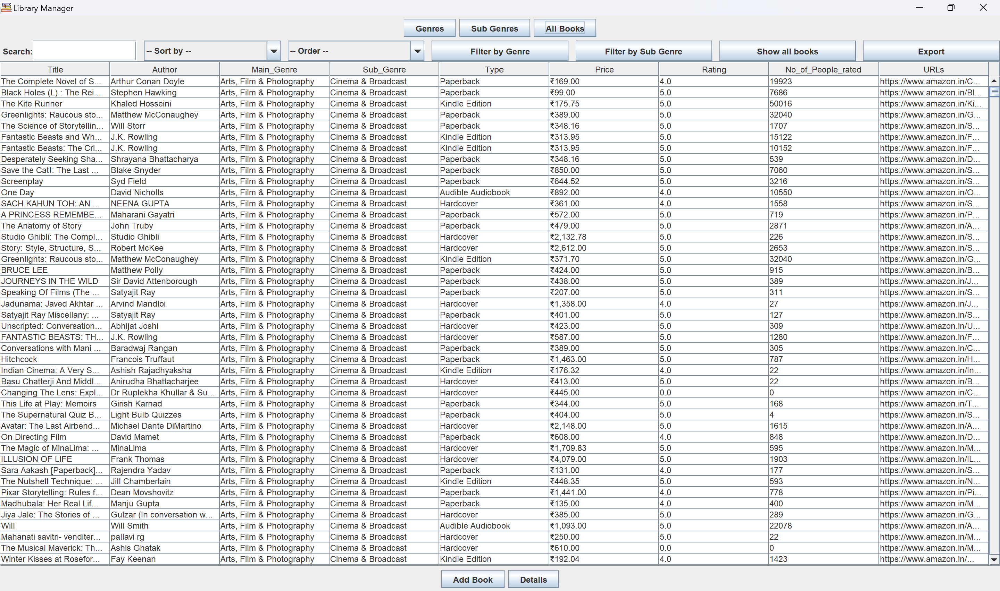
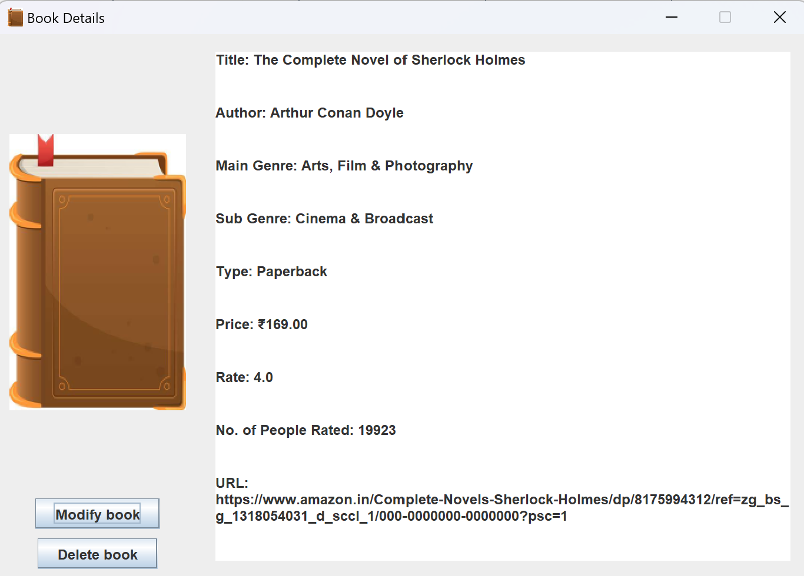
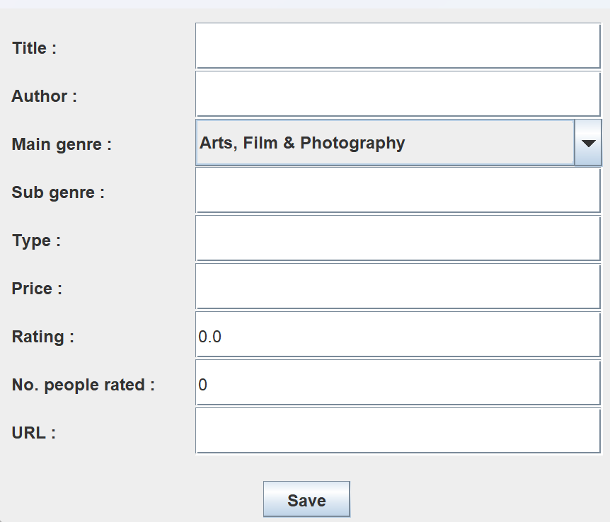

# Library Manager

A desktop application written in **Java Swing** to manage a book library. Books, genres and sub-genres are stored in a **MySQL** database and displayed in sortable, searchable tables. The project follows an **MVC architecture** with a DAO/Service layer.

## Features

- 📚 Browse all books in a table (title, author, genre, sub-genre, type, price, rating…)
- 🔍 Live search bar filtering on title and author
- ↕️ Sort books by price or rating (ascending/descending)
- 🏷️ Filter books by one or several genres / sub-genres
- ➕ Full CRUD: add, modify and delete books, genres and sub-genres through dedicated forms
- 📊 Statistics reports: average rating and price per genre / sub-genre
- 📄 Export any table to PDF (iText)

## Tech stack

| Layer | Technology |
|---|---|
| UI | Java Swing (JTable, CardLayout multi-page navigation) |
| Database | MySQL + JDBC (mysql-connector-j) |
| Data import | OpenCSV (books/genres dataset loaded from CSV) |
| PDF export | iTextPDF 5 |
| Build | Maven (Java 17) |

## Project structure

```
src/main/java/org/library_manager/
├── App.java                  # Entry point
├── controller/Controller.java # All UI event handling (ActionListener)
├── model/                    # Entities + DAO (SQL) + Service layer
├── view/                     # Frames, dialogs and table models
├── database/                 # Connection factory + CSV import tools
└── utilitary/PDFExporter.java
```

## Setup

### 1. Database

You need a local MySQL server running on `localhost:3306`.

```sql
CREATE DATABASE lm_database;
```

### 2. Configuration

Copy `src/main/resources/config.properties.example` to `src/main/resources/config.properties` and fill in your credentials:

```properties
db.url=jdbc:mysql://localhost:3306/LM_DataBase
db.user=root
db.password=YOUR_PASSWORD
```

(`config.properties` is gitignored — credentials never leave your machine.)

### 3. Build

```bash
mvn compile
```

### 4. Load the dataset (optional)

Run these classes once, **in this order** (foreign keys):

1. `database.GenresCSVtoMySQL`   → creates and fills `genre_df`
2. `database.SubGenreCSVtoMySQL` → creates and fills `sub_genre_df`
3. `database.BooksCSVtoMySQL`    → creates and fills `books_df`

### 5. Run

```bash
mvn exec:java -Dexec.mainClass="org.library_manager.App"
```

or run `App.main()` from your IDE.

## Screenshots





## UML

Class and use-case diagrams are available in the `diagram/` folder (drawio format).

## Author

Antoine Perfettini — student project.
